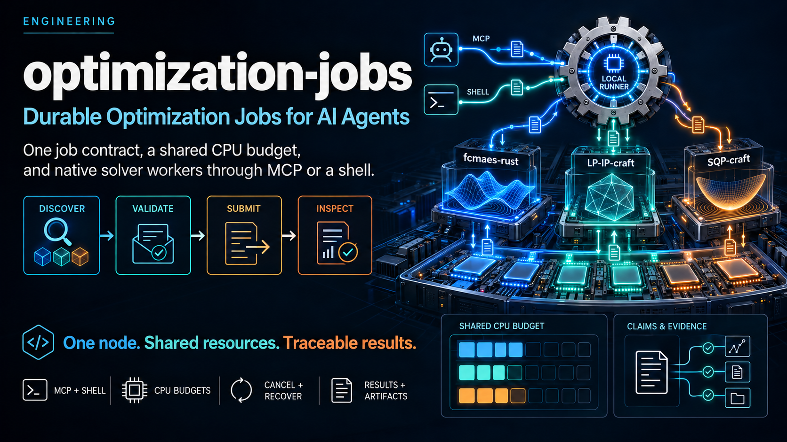

<p align="center">
  
</p>

# optimization-jobs

**Open-source optimization for AI agents:**
[ecosystem overview](https://dietmarwo.github.io/optimization-jobs/) ·
[shared solver-selection guide](ai-context.md).

Choose between Python/Rust black-box optimization, LP/MIP and smooth nonlinear
solvers. This repository provides their shared shell/MCP job layer; it has no
solver of its own.

Durable, versioned optimization jobs for agents and people: a strict job
envelope, a result contract with claims and evidence, a worker SDK, a local
runner, `optimization-run`, that schedules native solver workers against one
CPU budget, and `optimization-mcp`, an MCP server that gives agents the same
jobs as tools and tasks.

An AI that wants to optimize anything, over MCP or a shell, starts with
[`ai-context.md`](ai-context.md): which of our solvers fits the problem,
library or job, installation, the job API and the MCP server, and where the
detailed documentation is. Over MCP, the tool `get_guide` returns it.
Coding agents working on this repository start with [`AGENTS.md`](AGENTS.md).

| Part | What it is |
| --- | --- |
| [`crates/optimization-job-api`](crates/optimization-job-api) | Job envelope `optimization.job/0.1`, result contract `optimization.result/0.2`, input hashes, checked journals, the worker SDK (`worker::run`, `Worker`, `Prepared`) and worker-declared artifacts (`artifact::declare`) |
| [`crates/optimization-runner`](crates/optimization-runner) | The `optimization-run` command: worker registration, staging, idempotency, CPU-slot admission, supervision, cancellation, deadlines, recovery and coded errors; and `optimization-mcp`, the MCP server over stdio |
| [`docs/job-api.md`](docs/job-api.md) | The guide: envelope, resources, lifecycle, claims and evidence, errors, recovery, agents and MCP |
| [`docs/job-api/schemas`](docs/job-api/schemas/optimization.job-0.1.schema.json) | JSON Schemas of the job envelope and the result manifest |
| [`docs/job-api/PLAN.md`](docs/job-api/PLAN.md) | Implementation plan and acceptance gates |
| [`scripts/job-api`](scripts/job-api/test_integration.py) | Shared acceptance harness, runner regression tests and a protocol fixture worker |

The solvers live in their own repositories, each with a worker, a runnable
tutorial and an `ai-context.md` for agents that model problems with it.
[Choosing a worker and profile](docs/job-api.md#choosing-a-worker-and-profile)
maps problem classes to profiles:

| Repository | Worker | Profiles |
| --- | --- | --- |
| [fcmaes-rust](https://github.com/dietmarwo/fcmaes-rust) | `fcmaes-job-worker` | `fcmaes.retry/1`, `fcmaes.mode/1`, `fcmaes.map-elites/1`, `fcmaes.surrogate/1` (experimental), `fcmaes.evaluate/1` |
| [LP-IP-craft](https://github.com/dietmarwo/LP-IP-craft) | `lp-ip-job-worker` | `lp-ip.solve/1`, `lp-ip.evaluate/1` |
| [SQP-craft](https://github.com/dietmarwo/SQP-craft) | `sqp-job-worker` | `sqp.solve/1`, `sqp.evaluate/1` |

## Install from source

Nothing has been published to crates.io yet; build from source. You need
Linux (the runner supervises processes through Linux interfaces), git, and
Rust 1.88 or newer (`rustup` from https://rustup.rs). Cargo fetches every
other dependency. Python 3.10 or newer is needed only for the test scripts.

```sh
git clone https://github.com/dietmarwo/optimization-jobs
cd optimization-jobs
cargo build --release --locked        # target/release/optimization-run, optimization-mcp
cargo install --path crates/optimization-runner --locked   # optional: both on PATH
```

The runner has no workers of its own. Each worker lives in one of our solver
repositories and builds there together with this runner; Cargo fetches this
repository at the revision the worker pins, so no second checkout is needed:

| Worker | Build from source |
| --- | --- |
| fcmaes | `git clone https://github.com/dietmarwo/fcmaes-rust && cd fcmaes-rust && cargo build --release --locked -p optimization-runner -p fcmaes-job-worker` |
| LP/MIP | `git clone https://github.com/dietmarwo/LP-IP-craft && cd LP-IP-craft && cargo build --release --locked -p optimization-runner -p lp-ip-job-worker` |
| Smooth NLP | `git clone https://github.com/dietmarwo/SQP-craft && cd SQP-craft && cargo build --release --locked -p optimization-runner -p sqp-job-worker` |

To use a runner built here with workers built elsewhere, register the
workers' executables by absolute path. [RELEASING.md](RELEASING.md)
describes the crates.io release.

## Quick start

Linux and Rust 1.88 or newer. In a worker repository, the runner and the
worker build together:

```sh
cargo build --release --locked -p optimization-runner -p fcmaes-job-worker
./target/release/optimization-run --root /tmp/node node init --capacity 8
./target/release/optimization-run --root /tmp/node workers add \
  --id fcmaes --executable ./target/release/fcmaes-job-worker
./target/release/optimization-run --root /tmp/node run --spec JOB.json
```

Or build the runner and the MCP server alone here with
`cargo build --release --locked`. One
runner serves every registered worker on a node. The
[guide](docs/job-api.md) explains jobs, results and the CPU budget; the
worker repositories' tutorials have complete example jobs.

## Agents

The same build makes `optimization-mcp`. Connect an MCP client to an
initialized node with registered workers, for example Claude Code:

```sh
claude mcp add optimization-jobs -- "$PWD/target/release/optimization-mcp" --root /tmp/node
```

Its fifteen tools serve the guide for agents (`get_guide`, this repository's
[`ai-context.md`](ai-context.md)), describe the node (with the CPUs and
memory the host gives it) and its workers (with JSON Schemas of their
payloads and runnable examples), store input files such as a new LP model
(`put_input`), validate, submit, follow, cancel and repair jobs, and read
results and artifacts, such as a running surrogate job's evaluation log in
pages; with the MCP Tasks extension, a submitted job is a task that
completes with the job's result. Jobs outlive the server. The server cannot
register workers or change the node. See
[Agents and MCP](docs/job-api.md#agents-and-mcp).

## Depending on this repository

A worker repository pins a revision in its workspace manifest:

```toml
[workspace.dependencies]
optimization-job-api = { git = "https://github.com/dietmarwo/optimization-jobs", rev = "FULL_COMMIT_SHA" }
optimization-runner = { git = "https://github.com/dietmarwo/optimization-jobs", rev = "FULL_COMMIT_SHA" }
```

A worker crate implements `optimization_job_api::worker::Worker` and calls
`optimization_job_api::worker::run`. To build `optimization-run` next to the
worker with `cargo build -p optimization-runner -p WORKER`, give the worker
`optimization-runner` as a normal dependency, even if it never uses it: with
workspace members named on the command line, Cargo selects other packages
only among the normal dependencies of those members (a dev-dependency is not
enough). To move to a newer revision, change `rev` and run
`cargo update -p optimization-job-api -p optimization-runner`.

To develop a worker and the shared crates together, patch the dependency with
a local checkout:

```toml
[patch."https://github.com/dietmarwo/optimization-jobs"]
optimization-job-api = { path = "../optimization-jobs/crates/optimization-job-api" }
optimization-runner = { path = "../optimization-jobs/crates/optimization-runner" }
```

## Tests

```sh
cargo fmt --all -- --check
cargo clippy --locked --workspace --all-targets -- -D warnings
cargo test --release --locked
cargo build --release --locked -p optimization-runner
python3 scripts/job-api/test_review.py            # with the fake worker
python3 scripts/job-api/test_mcp.py               # the MCP server
python3 scripts/job-api/test_integration.py \
  --fcmaes /path/to/fcmaes-job-worker \
  --lp-ip /path/to/lp-ip-job-worker --sqp /path/to/sqp-job-worker
```

The schema checks need `pip install "jsonschema>=4.18,<5"`; CI sets
`JOB_API_REQUIRE_SCHEMA=1` so they cannot be skipped. CI also builds the three
workers from their repositories' `main` and runs the harness on a mixed node.
Worker repositories run the same scripts from Cargo's checkout of this
repository, with `JOB_API_TARGET` pointing at their own `target/release`
([guide](docs/job-api.md#extending-and-testing)).

## License

MIT, see [LICENSE](LICENSE).
