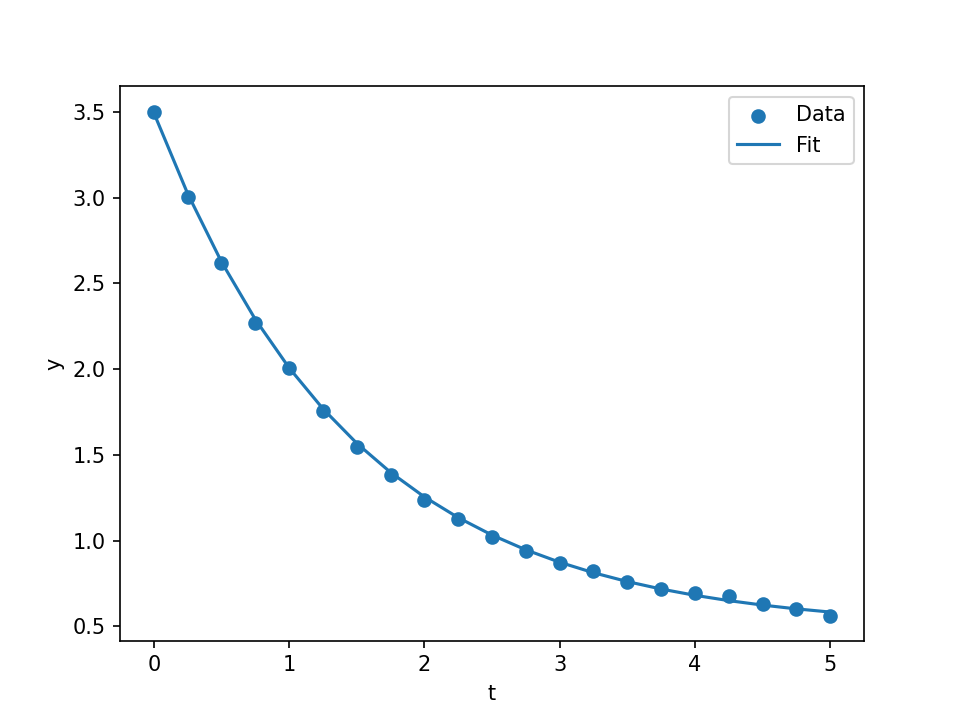

# Fit data and distinguish best-found from first-order evidence

[Series](../README.md) · [Copyable prompt](prompt.md) · [Original model](https://github.com/dietmarwo/fcmaes-rust/tree/main/tutorials/job-api)

## Ask the agent

> Fit the supplied exponential-decay examples using the fcmaes and SQP application workers. Plot the fits and explain what each solver actually verified.

For a complete runnable instruction, paste [prompt.md](prompt.md) into an agent with a Linux shell, a Rust toolchain and checkouts of the five repositories, or use a prepared node with these workers. The maintained model is already implemented; the user supplies goals and interprets decisions.

## What the agent executes

Use both checked-in CSVs and the corresponding original job specifications. Independently recompute squared residual loss: the fcmaes example uses the full sum of squares, while SQP uses half the sum of squares. For SQP also check the anchor equality and inspect KKT evidence. The two examples have different data, objective scaling and constraints, so they are not a solver speed or accuracy comparison.

## Inspect the result

Two fit plots, hashed data, original-unit residual recomputation, and separate best_found and first_order outcomes. Neither claim certifies a global nonlinear optimum.

The reference driver preserves every submitted specification, schema-validated results, worker discovery, hashes and work counters. It produces `report.json`; inspect individual result records rather than inferring success from lifecycle `completed`.

## Example executed result

Both original jobs completed. Independent CSV calculations gave fcmaes SSE 0.0104734 and SQP half-SSE 0.00205242. All four SQP starts met the original anchor and first-order checks; the largest anchor residual was about 1.44e-10 against tolerance 1e-7. Different datasets, loss scaling and constraints prevent using these values to rank the solvers.

Source: [retained pilot summary](../validation/pilot-summary.json); see [validation](../VALIDATION.md) for scope and exact checks.

## Continue the conversation

> To make a fair comparison, first define a shared dataset, identical bounds, the same objective and the same constraints, then implement and test that common model. Do not compare the current loss values as a ranking.

## Equivalence and limits

Both application workers already exist. Their binaries are copied to distinct names during setup to avoid the examples/custom_worker filename collision in a shared Cargo target directory. No numerical API change is needed.

See [validation](../VALIDATION.md) for the executed campaign and model-trial status.
