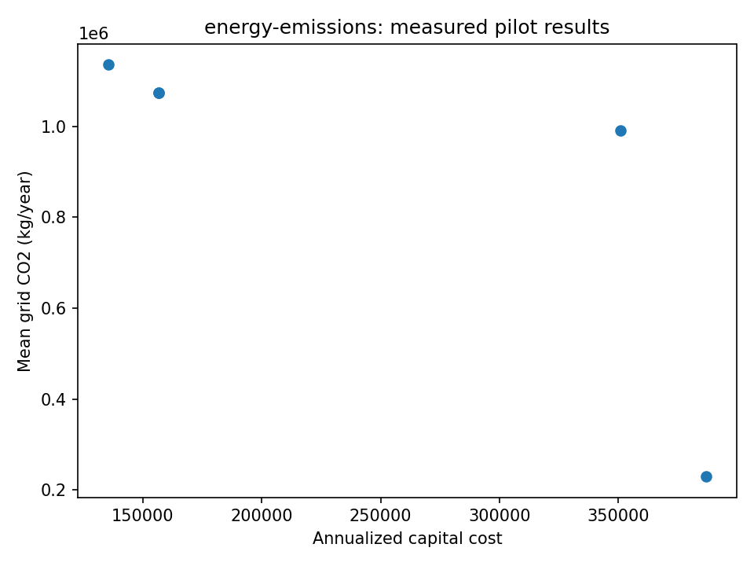

# Size an energy hub and inspect its dispatch

[Series](../README.md) · [Copyable prompt](prompt.md) · [Original model](https://github.com/dietmarwo/fcmaes-rust/tree/main/tutorials/energy-hub-bilevel)

## Ask the agent

> Size PV, wind, battery and grid connection for the energy-hub teaching model. Show cost and emissions trade-offs, explain constraint violations, and check the chosen design on the reserved scenarios.

For a complete runnable instruction, paste [prompt.md](prompt.md) into an agent with a Linux shell, a Rust toolchain and checkouts of the five repositories, or use a prepared node with these workers. The maintained model is already implemented; the user supplies goals and interprets decisions.

## What the agent executes

Retain microlp inside every design evaluation. Measure the original analytic baseline and retain it if the small scalar search does not improve it. Use the separate checked model to report all four engineering constraints, then evaluate the frozen selection with scenario_set=holdout. Also run the independent one-hour LP-IP-craft dispatch lesson and check its balance and cost.

## Inspect the result

The driver writes both `energy-pareto.png` (cost versus worst unserved energy) and `energy-emissions-pareto.png` (cost versus emissions). Inspect all four objectives in the retained records; a small front may include duplicate points. The analytic scalar baseline is not automatically engineering-feasible, so use the checked model for the selected design.

Scalar baseline and search results, MODE and QD pilots, training and holdout feasibility, a Pareto plot, and a one-hour dispatch LP with grid=200, solar=200, unserved=0, cost=50.

The reference driver preserves every submitted specification, schema-validated results, worker discovery, hashes and work counters. It produces `report.json`; inspect individual result records rather than inferring success from lifecycle `completed`.

## Example executed result

The scalar pilot improved the penalized baseline score from 0.19668 to 0.05778. The selected design passed all four checked constraints on both training and reserved scenarios; its holdout mean LCOE was 0.05774 in the teaching model's cost units. Some cheap MODE points left substantial demand unserved: the MODE formulation treats service loss as an objective, so inspect it even when its three declared constraints pass. The separate one-hour LP returned grid/PV/unserved = 200/200/0, with balance 400 and cost 50.

Source: [retained pilot summary](../validation/pilot-summary.json); see [validation](../VALIDATION.md) for scope and exact checks.

## Continue the conversation

> Increase the sizing budget while keeping the scenario protocol fixed. Do not use holdout results to tune the same experiment. Treat a change from smoke to publication horizons as a new numerical experiment.

## Equivalence and limits

The bilevel model still uses microlp. LP-IP-craft solves a separate one-hour example: 400 kWh demand, 200 kWh PV available, 500 kWh grid limit, grid price 0.25, unserved penalty 10. It does not replace the full scenario backend. Original MODE makes unserved energy an objective; the checked profile additionally enforces the scalar model's unserved-energy limit. QD uses D1 and a small square pilot archive; the original 12x10 retention gate is not reproduced by that pilot.

See [validation](../VALIDATION.md) for the executed campaign and model-trial status.
