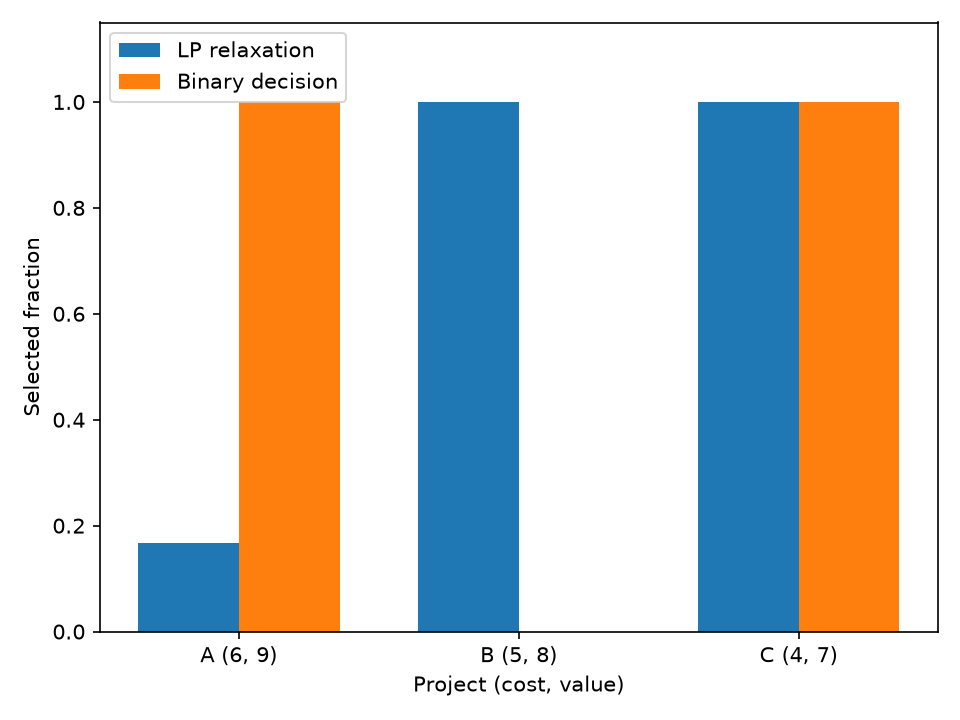

# Turn project choices into a checked LP and integer decision

[Series](../README.md) · [Copyable prompt](prompt.md) · [Native reference](https://github.com/dietmarwo/LP-IP-craft/tree/main/tutorials/job-api)

## Ask the agent

> Choose projects under a budget of 10 units. A costs 6 and returns value 9, B costs 5 and returns 8, and C costs 4 and returns 7. Projects are indivisible. Show what the fractional LP relaxation tells us and verify the integer answer.

Paste [prompt.md](prompt.md) into an agent with the prepared Linux shell environment described in [SETUP.md](../SETUP.md). The reader supplies goals; the worker executes the maintained model.

## Problem card

| Project | Cost | Value | Variable |
|---|---:|---:|---|
| A | 6 | 9 | Binary |
| B | 5 | 8 | Binary |
| C | 4 | 7 | Binary |

Maximize total value with total cost at most 10 and each variable in [0,1]. All coefficients and rows are linear. This is a deliberately small, auditable model. The worker accepts general LP/MIP data through `lp-ip.model/1`; its schema is discoverable. No custom worker is needed for these coefficient changes.

## What the agent executes

1. Write and hash the model, validate its schema, then solve a continuous copy as an upper bound on this maximization problem.
2. Solve the binary model from a cold start and from a density-greedy feasible candidate. Starts are independent tasks, not a resumed branch-and-bound tree.
3. Enumerate the eight binary assignments outside the solver; verify objective, budget, bounds, integrality, reported bounds and gaps. The LP has a separate fractional-knapsack oracle because this particular model has one budget row.
4. Evaluate the integer result, relaxation point and all-selected point with the binary model to expose the difference between fractional feasibility and integer feasibility.
5. Force all three selections. Their cost is 15, so a capacity below 15 is inconsistent. Preserve the solver's actual `infeasible`/`claimed` result alongside that elementary contradiction.

## Inspect the result

`lp-ip-summary.json`, `lp-ip-allocation.png`, checked model JSON artifacts, solve/evaluate results and work counts. For a maximization problem the LP relaxation and dual bound are upper bounds; an incumbent supplies a lower bound. `numerical_optimum` is numerical evidence under tolerances. LP KKT checks are not MIP dual checks. An infeasibility claim currently has no exported certificate and must not be presented as rechecked proof from the worker.

## Example executed result

At capacity 10, both MIP starts selected A+C, cost 10 and value 16. The relaxation selected (1/6, 1, 1), value 16.5: an absolute integrality gap of 0.5. Independent enumeration and the fractional-knapsack calculation agree. The worker's numerical bounds are retained in their original maximization sense.

At capacity 9, the fresh-agent follow-up selected B+C, cost 9 and value 15; the LP relaxation is already integral and the gap is zero. Forcing all projects remained infeasible in both runs. That outcome has `claimed` evidence; the separate cost contradiction does not become a worker-exported certificate.

Source: [retained default pilot summary](../validation/additional-pilot-summary.json); the same summary retains the follow-up results.

## Continue the conversation

> Reduce the budget from 10 to 9 without changing values, project costs or tolerances. Rerun in a new directory and explain how the chosen projects and integrality gap change. Regenerate the model checksum after changing its capacity.

Use `--lp-capacity 9`. The driver accepts capacity strictly between 0 and 15 so the deliberate all-selected infeasibility case remains meaningful. The chapter retains native solve budgets from the original LP/IP job tutorial and uses at most two CPU slots. Its cold and warm MIP tasks are a correctness exercise, not a speed comparison. Do not generalize tiny exhaustive enumeration to large MIPs.

See [VALIDATION.md](../VALIDATION.md) for execution evidence and limits.
