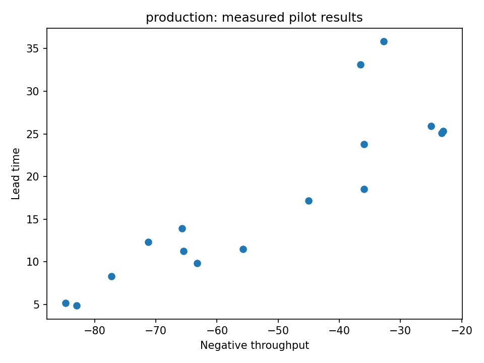

# Improve a production line without overfitting its random events

[Series](../README.md) · [Copyable prompt](prompt.md) · [Original model](https://github.com/dietmarwo/fcmaes-rust/tree/main/tutorials/nexosim-production-line)

## Ask the agent

> Find production-line operating policies balancing throughput, lead time, work in progress and operating cost. Include staffing and buffer capacity, and tell me how reliable the shortlist is.

For a complete runnable instruction, paste [prompt.md](prompt.md) into an agent with a Linux shell, Rust toolchain and these patched sources, or use a prepared node with these workers. The maintained model is already implemented; the user supplies goals and interprets decisions.

## What the agent executes

Use MODE on the original NeXosim model and a small MAP-Elites pilot. Freeze the training simulation seed at 42; choose three policies using training throughput, then re-evaluate those exact policies with simulation seed 314159. Keep simulator execution serial inside each candidate and let the job layer own candidate concurrency.

## Inspect the result

A training Pareto plot, a QD archive, and separate training/holdout objective vectors for identical controls. A deterministic recheck alone does not establish robustness.

The reference driver preserves every submitted specification, schema-validated results, worker discovery, hashes and work counters. It produces `report.json`; inspect individual result records rather than inferring success from lifecycle `completed`.

## Example executed result

With two replications over 120 minutes, the three training-selected policies had throughput 84.75, 83.00 and 77.25 per hour. Holding their controls fixed and changing the simulation seed to 314159 gave 81.50, 81.00 and 75.75. The ranking persisted in this small check; two replications do not establish ranking reliability or confidence intervals.

Source: [retained pilot summary](../validation/pilot-summary.json); see [validation](../VALIDATION.md) for scope and exact checks.

## Continue the conversation

> Increase replication count for the same frozen shortlist without optimizing on the holdout seeds. Show whether its apparent ranking is stable. More replications change the workload; record the change.

## Equivalence and limits

The original decoder and replication aggregation are reused. The stock job MODE profile does not expose integer mutation masks, so it optimizes real encodings that the original decoder rounds. This preserves physical decisions and objective values, but is not a bit-identical replay of the original integer-aware MODE campaign.

See [validation](../VALIDATION.md) for the executed campaign and model-trial status.
