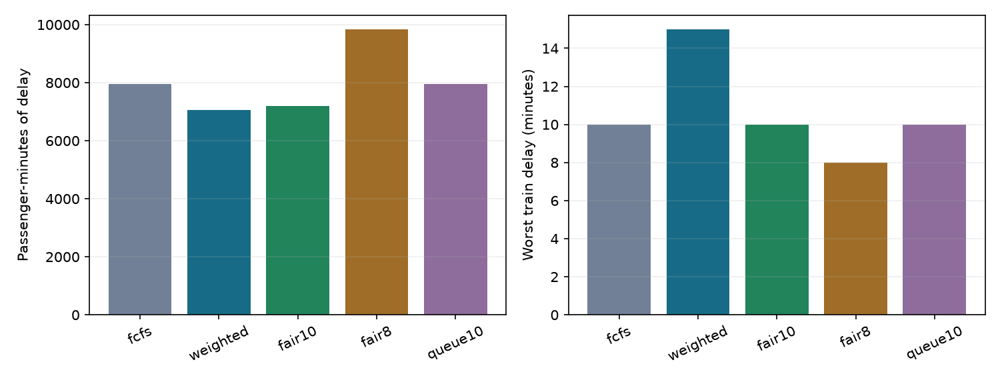
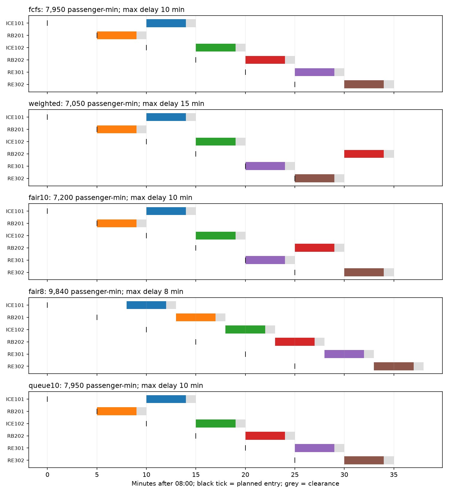
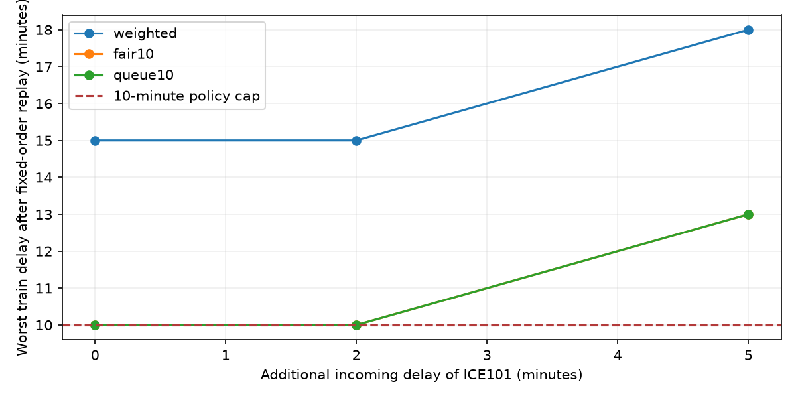

# Recover a disrupted timetable with an AI agent

**A practical workshop for an AI lead in rail operations**

Synthetic data. Executed native optimization. Copyable prompts. Prepared 23 October 2026.

An incoming train is eight minutes late. Six passenger trains need the same single-track bottleneck. Which should go first, who absorbs the delay, and does the proposed improvement survive a more realistic operating constraint?

This tutorial turns that question into a checked experiment. The reader describes objectives through prompts; an agent builds or runs a bounded optimization job and returns a decision brief with evidence. The agent can use a shell or a configured MCP interface. No particular model provider is required.

## Why this is relevant

DB already describes AI-supported conflict management for S-Bahn operations [1]. A 2025 paper by Stephan Zieger and Hannah Richta describes DB InfraGO's ADA-PMB dispatching assistant and its interface to dispatchers [2]. This independent workshop is a small educational example for discussing an agent layer around existing planning tools, rather than a proposed replacement for those systems.

The useful management question is: **can an agent turn a request into an explicit decision model, expose its assumptions, run reproducible alternatives and explain why an operator might reject the best-scoring answer?**

You will see three different outcomes: a lower delay score, a compromise that limits the worst train delay, and a missing infrastructure constraint that eliminates the apparent gain. A fourth experiment shows when an incoming disruption makes the requested policy impossible.

## What each component does

| Component | Responsibility |
|---|---|
| Human decision owner | Defines the service objective and acceptable policy limits |
| AI agent | Reads the request, prepares experiments, inspects evidence and explains trade-offs |
| optimization-jobs | Validates inputs, budgets execution and retains specs, results and hashes |
| LP-IP-craft | Solves the bounded mixed-integer model using the existing native worker |
| Independent checker | Recomputes timetable feasibility and metrics from the train data |

This is an offline planning demonstration. Its one-block clearance rule does not implement signalling, braking, route locking or a railway safety case. No real DB network data or operational interface is used.

<!-- pagebreak -->

## The scenario: a bottleneck at 08:00

All times below are minutes after 08:00. The block is initially empty. Every train occupies the whole block for four minutes; one additional minute of model clearance separates successive entries, irrespective of direction. Trains can wait at their approaches. The first experiments assume enough holding/passing capacity to change their order. Later, we remove that assumption.

| Synthetic train | Direction | Planned entry | Earliest ready | Passengers |
|---|---|---:|---:|---:|
| ICE101 | A-B | 0 | 8 | 420 |
| RB201 | B-A | 5 | 5 | 60 |
| ICE102 | B-A | 10 | 10 | 300 |
| RB202 | A-B | 15 | 15 | 90 |
| RE301 | A-B | 20 | 20 | 240 |
| RE302 | B-A | 25 | 25 | 120 |

The names, loads and times are invented. Passenger counts are example weights, not DB priority rules. The horizon is 60 minutes; all trains must finish inside it. There are no cancellations, diversions, early departures or broken connections in this model.

**Metric:** for each train, delay is actual entry minus planned entry. Multiply that delay by its passenger count and add across trains. This gives passenger-minutes at the bottleneck, not door-to-door passenger delay or DB's reported punctuality KPI. We also report total train-minutes and the largest individual delay.

**Decision model:** six continuous entry times and 15 binary order variables, one per train pair. Each train must wait until its planned and ready times. Every pair must occupy the resource in one order or the other, with the stated clearance. The unrestricted MIP has 21 variables and 30 linear rows. Delay caps and queue preservation add rows. Finite bounds come from readiness and the horizon; big-M constants are derived from those bounds.

**Baseline:** first come, first served (FCFS), ordered by effective readiness, then planned time and ID. Admit each train as soon as it and the block are available. This is a transparent comparator, not a claim about DB's actual dispatching policy.

**Separate oracle:** six trains have 720 possible orders. For any fixed order, positive delay weights make the earliest feasible starts best. Exhaustively checking these orders therefore gives an independent optimum for this small model, including its caps and queue rules. This method does not scale to a rail network.

The complete fixture is [scenario.json](scenario.json); the reproducible model builder and checker are in [rail.py](rail.py).

<!-- pagebreak -->

## Start with this prompt

Prepare the environment in [SETUP.md](SETUP.md), then paste the following. The more detailed [prompt.md](prompt.md) includes exact limits and evidence requirements.

> Act as my optimization analyst for the synthetic rail bottleneck in scenario.json. Read the shared solver guide and the LP/IP worker discovery. State the model, units, assumptions and missing operational constraints before running it. Use optimization-jobs and its existing LP/IP worker; the supplied driver can orchestrate the experiments.
>
> Compare FCFS with a timetable that minimizes passenger-minutes. Then repeat with maximum train-delay caps of 10 and 8 minutes. Keep the original input data, clearance and numerical tolerances. For every plan, show each train's entry and delay, passenger-minutes, total train-minutes and worst delay. Use a cold solve and a simple feasible baseline start where available.
>
> Add a no-overtaking rule on both approaches, preserving each direction's planned order, and solve again with the 10-minute cap. Explain whether the claimed benefit survives. Solve the continuous relaxation as a lower bound and explain why its time vector may not be a usable timetable.
>
> Independently check the schedules and compare with exhaustive enumeration of the 720 orders. Re-evaluate the optimum, FCFS and a deliberately conflicting point through the worker. Preserve actual termination, numerical bounds, gap, evidence and work counts.
>
> Replay the selected sequences with 0, 2 and 5 extra minutes of incoming delay for ICE101, never advancing a committed slot. Separately re-optimize the five-extra-minute case under the 10-minute cap. Do not silently relax an impossible requirement. Return a concise decision brief, timetable and trade-off plots, retained files and the limits of the model. Use only synthetic, local data.

## What a good agent response should contain

1. A problem card and a list of assumptions, including whether overtaking is allowed.
2. Executed results with identifiable input/spec/result files, not a plausible invented timetable.
3. Each train's consequences, alongside aggregate improvements and the policy cost.
4. Worker claims kept separate from independent model checks and railway validity.
5. A recommendation conditional on the infrastructure and policy assumptions.

For a German conversation, use the opening in [follow-up-prompts.md](follow-up-prompts.md). The same file contains demand-sensitivity and pilot-design prompts.

## What was actually tested

The implementation executes seven real jobs per scenario: four MIP policy comparisons, a point-evaluation job, an LP relaxation and the deliberately infeasible stress case. The default and two demand follow-ups completed **21 jobs / 39 result records**. All feasible MIP task objectives agreed with the independent order oracle. No fresh-context model trial was performed; these are executed driver/worker experiments and code tests, not a claim about general model ability.

The formulation tests compare the MIP rows and independent checker over all 720 orders for four policy settings. They also reject collisions, early entry, queue violations and malformed input. A CI matrix entry builds and executes this chapter using only optimization-jobs and LP-IP-craft. Details, versions and retained summaries are in [VALIDATION.md](VALIDATION.md) and [validation.json](validation.json).

<!-- pagebreak -->

## Measured result: improvement has a distribution

These are executed results from the native worker for the fixture above, with two CPU slots. Tiny floating-point roundoff is rounded only in the presentation; the JSON retains the values.

| Policy | Passenger-minutes | Train-minutes | Worst delay |
|---|---:|---:|---:|
| FCFS baseline | 7,950 | 30 | 10 min |
| Weighted delay, reordering allowed | 7,050 | 30 | 15 min |
| Maximum delay 10 min | 7,200 | 30 | 10 min |
| Maximum delay 8 min | 9,840 | 48 | 8 min |
| Preserve approach queues, cap 10 min | 7,950 | 30 | 10 min |

The unrestricted optimum improves passenger-minutes by **11.3%** against this FCFS baseline, but RB202's delay grows from 5 to 15 minutes. Total train delay stays at 30 minutes: the improvement comes from redistributing delay, not removing it.

The 10-minute cap costs 150 passenger-minutes relative to the unrestricted optimum and retains a **9.4%** improvement over FCFS. The eight-minute cap forces a different choice: wait for ICE101 and delay all six trains by eight minutes. A stricter worst-delay policy increases the total burden in this instance.

**The crucial operational check:** both improved plans move RE301 ahead of RB202 on the A-B approach. If those trains cannot overtake there, that decision is unavailable. Preserving the planned queue on each approach brings the optimum back to **7,950**, identical to FCFS. A correct optimizer can therefore report a useful-looking gain that disappears when a missing constraint is added.

The LP relaxation returns **3,360** passenger-minutes. Fractional order variables allow overlapping occupancies: this is a lower bound for the unrestricted MIP, not an executable timetable.

<!-- pagebreak -->

## Inspect the actual timetable

Colored bars show exclusive block occupancy, grey bars the model clearance. Black ticks show planned entry. The row names are the same across all five policies.

In the weighted plan, RB202 waits until 08:30, while RE301 and RE302 pass earlier. In the 10-minute-cap plan, RB202 passes at 08:25. The queue-preserving solution restores its 08:20 slot and the original FCFS outcome.

<!-- pagebreak -->

## Ask what happens when the prediction is wrong

> ICE101 arrives another two or five minutes later than expected. Keep the recommended sequence and do not advance a committed slot. Propagate the change, show violations, then explain whether re-optimization could still satisfy the original 10-minute cap.

The nominal 10-minute-cap plan absorbs two additional minutes: ICE101 was already waiting until minute 10. With five extra minutes, its earliest entry becomes minute 13. It is now at least 13 minutes late, so a 10-minute cap is impossible even before considering any other train.

The actual re-optimization job reports `infeasible` with `claimed` evidence. The worker exports no infeasibility certificate. The arithmetic contradiction above and the exhaustive check are separate evidence for this tiny model; they do not upgrade the worker's evidence label.

The replay assesses all three policies against the same 10-minute cap. The unrestricted weighted plan already violates that cap in the nominal case. At five extra minutes, its worst delay reaches 18 minutes; the nominal capped and queue-preserving plans reach 13 minutes. All still respect the block-occupancy rule after propagation.

These are three specified stress cases with no probability distribution. They do not establish a reliability percentage or a robust optimization guarantee. A useful next experiment would add independently assessed arrival uncertainty and new decisions that the operating process actually permits.

## Test the estimated passenger loads

The follow-up prompt doubles RB202's load, then separately halves ICE101's load. It requires fresh scenario files, separate output directories and all policy results. This demonstrates sensitivity to decision weights without claiming that passenger-count prediction is solved. Both follow-ups were executed; see [VALIDATION.md](VALIDATION.md).

<!-- pagebreak -->

## Turn the lesson into an offline pilot

Start with one decision type and one bounded area that the operations team considers useful. An agent's contribution is making model choices, evidence and counterfactuals accessible. Its language output is not the feasibility checker.

| Pilot decision | Concrete requirement |
|---|---|
| Decision owner | A named operations role defines what may be changed and reviews recommendations |
| Existing tools | Establish how the pilot would use the existing dispatching/model interface and avoid duplicating it |
| Inputs | Timestamped forecasts; topology and conflict resources; running/dwell times; usable holding capacity; relevant connection, rolling-stock and crew dependencies |
| Policy | Agree weights, delay limits, protected connections and treatment of different services with operations |
| Evaluation | Replay unseen historical disruptions using only information available at each decision time; compare with actual or incumbent decisions on the same assumptions |
| Acceptance evidence | Independent constraint violations, passenger/service effects, worst affected trains, runtime, fallback behavior and operator rejection reasons |

Compare model formulation and runtime with an established optimization baseline before choosing a solver for an industrial problem. This six-train experiment does not establish network-scale performance. Do not treat historical dispatcher actions as a perfect optimum or evaluate a forecast using information that became available later.

Keep prediction, optimization and explanation measurable separately: better arrival forecasts, a better feasible decision for the same forecast, and a more accurate explanation are three different gains. Introduce operational integration only after the offline model, feasibility checks and decision process have been assessed with the responsible team.

## Sources and technical entry points

[1] Deutsche Bahn, [Artificial intelligence at DB](https://www.deutschebahn.com/en/artificial_intelligence-6935068), accessed 23 October 2026. Context for existing AI-supported traffic management.

[2] Stephan Zieger and Hannah Richta, [DB InfraGO's Automated Dispatching Assistant ADA-PMB](https://arxiv.org/abs/2505.10085), 2025. A primary-source account of dispatching assistance and its operational interface; its deployment statements describe that publication's date.

[3] [optimization-jobs](https://github.com/dietmarwo/optimization-jobs) and its [shared solver guide](https://github.com/dietmarwo/optimization-jobs/blob/main/ai-context.md); [LP-IP-craft job tutorial](https://github.com/dietmarwo/LP-IP-craft/tree/main/tutorials/job-api). The executable contracts used here.

The scenario, experiment design, model, checks and figures in this tutorial are original synthetic examples. They are not derived from private DB operating data and imply no DB endorsement.
