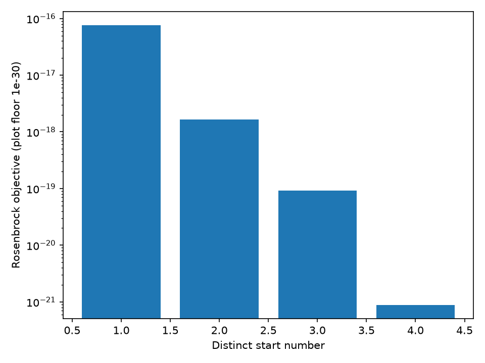

# Check constrained SQP results across starts and backends

[Series](../README.md) · [Copyable prompt](prompt.md) · [Native reference](https://github.com/dietmarwo/SQP-craft/tree/main/tutorials/job-api)

## Ask the agent

> Allocate one unit across four nonnegative shares while minimizing the sum of squared shares. Solve from different initial allocations with both QP backends, and explain what the reported first-order evidence establishes.

Paste [prompt.md](prompt.md) into an agent with the prepared Linux shell environment described in [SETUP.md](../SETUP.md). The reader supplies goals; the worker executes the maintained model.

## Problem card

The constrained model is smooth with analytic gradients/Jacobians: minimize the sum of n squared shares, subject to their sum being one and each share in [0,1]. At n=4, the unique analytic solution has four equal shares and objective 1/4. The inequality sum(x_i^2) >= (sum x_i)^2/n proves that fact for this model. That argument is separate from the worker's first-order numerical claim.

## What the agent executes

1. Inspect the registered `benchmark.simplex` model and the solve/evaluate schemas. Use four distinct starts: uniform, a corner, increasing normalized shares, and zero (inside the box but outside the equality).
2. Run both `active_set` and `clarabel` with identical starts, 200-iteration/4000-callback limits, feasibility tolerance 1e-7 and stationarity tolerance 1e-6.
3. Independently recompute objective, equality and interior equality-stationarity residuals. Inspect all worker KKT components and termination reasons.
4. Evaluate uniform, corner and zero points without solving. The corner is feasible but is not the minimizer; evaluation alone does not assert first-order optimality.
5. Run two-dimensional Rosenbrock from four distinct starts, recheck the returned points and recompute gradients. Preserve every start's result, including any failure.

## Inspect the result

`sqp-summary.json`, `sqp-allocation.png`, `sqp-multistart.png`, retained specs/results and separate function, derivative, iteration and QP-iteration counts. A `first_order` outcome means the worker rechecked declared KKT tolerances, not a general second-order or global certificate. Nonconvergence is not proof of infeasibility. For Rosenbrock the model has a known zero minimum, but an optimizer result still needs its actual evidence.

## Example executed result

Both backends, from all four starts, returned uniform four-share allocations with objective 0.25 and rechecked `first_order` evidence. The eight-share follow-up returned objective 0.125, agreeing with the analytic prediction. The corner evaluation was feasible without being optimal; the zero vector failed the equality.

All four Rosenbrock starts converged in this pilot. Their objective values ranged from 8.88e-22 to 7.58e-17; the largest independently recomputed gradient infinity norm was 3.48e-7, below the declared 1e-6 stationarity tolerance. The figure uses a labelled 1e-30 floor only to keep zero values plottable; exact objectives remain in JSON. These results do not prove convergence for other starts or applications.

Source: [retained default pilot summary](../validation/additional-pilot-summary.json); see [validation](../VALIDATION.md) for follow-up results and the model trial's prediction-order correction.

## Continue the conversation

> Repeat the allocation at eight shares with the same tolerances and starts policy. Predict the analytic objective before running it, then check every backend/start result against that prediction. Keep the Rosenbrock demonstration separate.

Use `--sqp-dimension 8` in a new output directory. The driver limits this teaching exercise to 2–32 shares; the native solver's broader dense-size limit is distinct. The two QP backends solve the same model here, unlike the different curve-fitting examples in the earlier chapter. Tiny models and one machine do not support a backend timing ranking. New nonlinear applications still need a registered native model with derivatives; prompts do not serialize callbacks.

See [VALIDATION.md](../VALIDATION.md) for execution evidence and limits.
