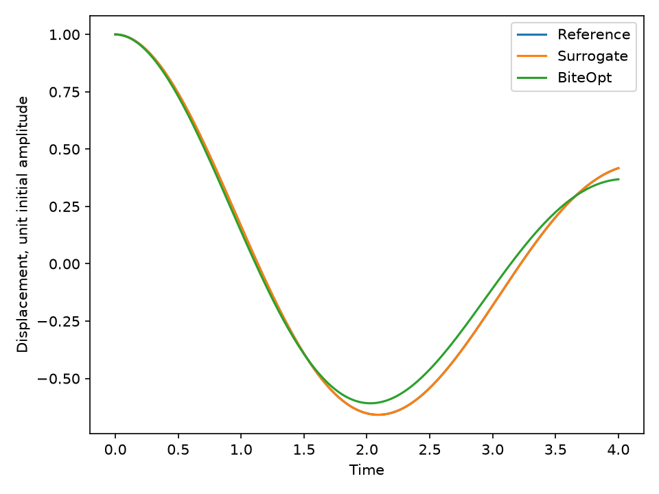

# Spend a small simulation budget with a surrogate

[Series](../README.md) · [Copyable prompt](prompt.md) · [Native reference](https://github.com/dietmarwo/fcmaes-rust/tree/main/tutorials/surrogate)

## Ask the agent

> Calibrate damping and stiffness from the oscillator observations using at most 32 new simulation calls. Compare with a 32-call BiteOpt run, and show how an agent can reuse observations in a later surrogate job.

Paste [prompt.md](prompt.md) into an agent with the prepared Linux shell environment described in [SETUP.md](../SETUP.md). The reader supplies goals; the worker executes the maintained model.

## Problem card

The two examples are deterministic scalar box problems with two continuous variables. Branin is a transparent benchmark. The oscillator uses the existing Rust RK4 simulation and analytic observations: damping in [0.05, 1.5], stiffness in [0.5, 4.0], 2048 integration steps and four ordered replicas. It has no synthetic delay. It is an inexpensive stand-in for an expensive simulator, not a wall-time speed benchmark.

## What the agent executes

1. Run Branin with 48 calls and retain the trace and observation snapshot as worker-declared artifacts. Independently recompute the reported Branin objective.
2. Check the snapshot's schema and hash, then submit a new job using its 48 observations and eight new calls. Check the retained values and the combined count of 56.
3. Run the same oscillator objective with 32 GP calls and a 32-call, one-retry BiteOpt baseline. Record the different parallel layouts; final validation is additional work.
4. Re-evaluate both fits and the known reference [0.4, 2.3], compare with the analytic solution, and plot convergence and fitted trajectories.

## Inspect the result

`surrogate-summary.json`, `surrogate-history.png`, `surrogate-oscillator.png`, the original artifact bytes and decoded trace pages under `artifacts/`, plus every submitted spec and result. `work.evaluations` counts new optimization callbacks, not retained history, validation calls or GP matrix factorizations. A warm job has fresh optimization state. The worker's `best_found` means the best usable observed point, not a posterior prediction or a certified optimum.

A snapshot must match the model identifier, version, dimension, resolved parameters, model-input hashes and (for simulation models) simulation seed. Model authors must bump the version when changing its meaning. A hash verifies the bytes; it does not establish the truth of supplied observation values. Treat imported history as trusted input and retain its provenance.

The current profile is experimental: deterministic scalar models, box constraints, 1–32 variables, at most 256 new plus retained observations, and at most eight inner threads. These limits come from the worker's discovery and must be checked before adapting the prompt. No noisy, constrained or mixed-integer BO capability is implied.

## Example executed result

With seed 42 and two slots, 48 Branin calls found 0.3978877083; eight new calls using the retained observations improved it to 0.3978876470. The combined snapshot contains 56 observations. At 32 new oscillator calls each, the GP fit had loss 2.36752e-8 and BiteOpt 0.00296418. Both returned `best_found` with rechecked evidence; the known reference re-evaluated to about 1.02e-24. Analytic trajectory losses agree with the native RK4 results within the declared checks.

The fresh-agent follow-up preserved all three requested seeds:

| Seed | GP oscillator loss | BiteOpt oscillator loss |
|---:|---:|---:|
| 42 | 2.36752e-8 | 0.00296418 |
| 7 | 3.66883e-8 | 0.000613904 |
| 19 | 3.22298e-8 | 0.00126137 |

These small deterministic experiments do not establish a general solver ranking or timing advantage. The two methods use different parallel layouts, and GP fitting adds work outside the simulation-call budget.

Source: [retained default pilot summary](../validation/additional-pilot-summary.json); the same summary retains the follow-up results.

## Continue the conversation

> Repeat the complete chapter with optimizer seeds 7 and 19 in separate output directories. Keep the 32-call comparison budgets and model fixed. Show how the two measured losses vary, including all unsuccessful runs. Do not pick a seed after seeing the result or call three seeds a general benchmark.

Change `--seed` for this follow-up. The chapter fixes 48/8/32/32 budgets; `--budget-scale` does not change them. Different batch sizes or seeds can change the proposal path from the original eight-slot tutorial. The model and artifact contracts are reused unchanged.

See [VALIDATION.md](../VALIDATION.md) for execution evidence and limits.
