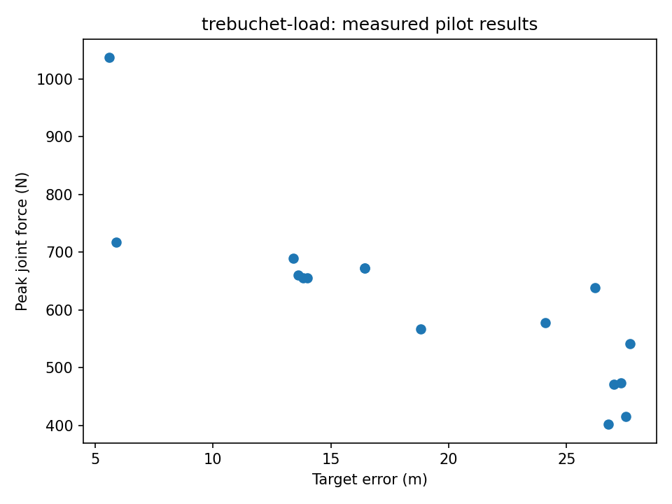

# Throw accurately, then choose the trade-off

[Series](../README.md) · [Copyable prompt](prompt.md) · [Original model](https://github.com/dietmarwo/fcmaes-rust/tree/main/tutorials/rapier-trebuchet)

## Ask the agent

> Find a good design for a throw to 35 metres. Show the trade-off between landing error, input energy and pivot load, and show different trajectories rather than only one winner.

For a complete runnable instruction, paste [prompt.md](prompt.md) into an agent with a Linux shell, a Rust toolchain and checkouts of the five repositories, or use a prepared node with these workers. The maintained model is already implemented; the user supplies goals and interprets decisions.

## What the agent executes

Run the scalar, MODE and MAP-Elites pilot. Recheck the scalar design with app.trebuchet.checked, inspect its release/landing validity, and generate the existing browser replay. Explain why a scalar penalty is not a constraint certificate.

## Inspect the result

Scalar best-found, a nondominated final population, an elite archive, checked release/landing status, Pareto plot and replay.html. A small pilot may be inaccurate or sparse.

The reference driver preserves every submitted specification, schema-validated results, worker discovery, hashes and work counters. It produces `report.json`; inspect individual result records rather than inferring success from lifecycle `completed`.

## Example executed result

The seed-42, two-slot pilot reduced checked landing error from 21.424 m to 0.0324 m at a 35 m target. The selected throw used 736.8 J with a 236.3 N peak joint force. MAP-Elites filled only 2 of 16 niches; those two replayed throws had different apex heights. The small MODE front was dominated by the scalar solution, so it is evidence of an underdeveloped search, not the full attainable trade-off.

Source: [retained pilot summary](../validation/pilot-summary.json); see [validation](../VALIDATION.md) for scope and exact checks.

## Continue the conversation

> Repeat for a 40 metre target in a new output directory with the same seed and budget. Compare actual landing error, energy and load. Keep the original result.

## Equivalence and limits

The objectives, bounds, time integration and descriptors call the original Rapier library. The generic worker owns retries and populations. MODE retains the original penalty formulation; the separate checked model adds explicit release/landing validity.

See [validation](../VALIDATION.md) for the executed campaign and model-trial status.
