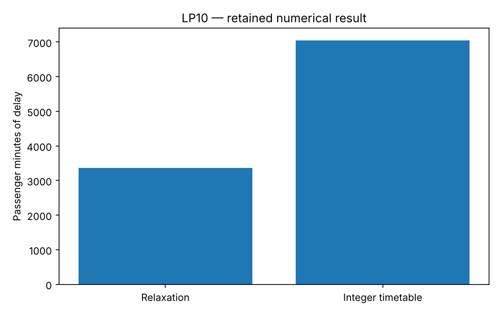

# LP10: Rail recovery: inspect the formulation

This chapter runs native Rust solvers through their Python APIs. Its model and independent checks live in this directory; the shared driver in optimization-jobs adds figures and command-job execution.

## Model and decision

Reuse rail.py from the existing agent chapter. Continuous start times and one binary per conflicting pair enforce occupation/clearance. The big-M derives from upper_i + occupation_i - lower_j, clipped at zero.

## Work through the lesson

Reuse `rail.py` and its checked six-train scenario. A binary chooses which train goes first for each conflicting pair. Its disjunction uses a big-M derived from the physical horizon and separation requirement.

1. Read the existing `make_model` and `replay` together. Trace one order binary into its two separation inequalities before looking at the objective.
2. Solve the relaxed and integer versions and evaluate each returned point against the model's rows independently. Passenger delay is 3,360 versus 7,050 minutes; the check requires the relaxation not to exceed the integer optimum. Fractional order decisions explain why the relaxed bound understates a feasible timetable's delay.
3. Enumerate all 720 orders independently and replay each earliest-start schedule. The best feasible order agrees with the integer model. Then solve the integer model again from a first-come, first-served order as a MIP start (`fifo_start`): that schedule has 9,840 passenger-minutes, and the solve still reaches 7,050. A start is a candidate, not an oracle, and not a resumed search.
4. Larger cases grow factorially: 8 trains have 40,320 orders and 10 have 3,628,800. Beyond the teaching fixture, native bounds and gaps become more useful than exhaustive enumeration.

## Run

Install the pinned solver packages and scientific dependencies as described in the [shared setup](../structured/README.md), with the repositories it lists cloned side by side. From this repository's root:

```bash
python tutorials/structured/run.py --chapter LP10 --output /absolute/new/lp10
```

To run the chapter on its own, use `python tutorials/rail-formulation/run.py --preset smoke --output /absolute/new/lp10-direct`. It produces JSON; the shared driver additionally renders PNG/SVG figures. `--preset study` runs the larger declared cases; a chapter without them repeats the smoke case. Output may be new or empty, and an occupied directory is refused.

## Independent answer and validation

The direct entry runs the relaxation and MIP on the maintained scenario, checks the timetable independently and compares the integer result with full order enumeration. Neither model nor data is copied.

Every run keeps the native status, points and available diagnostics. Application-specific references are computed separately. All failures remain in the report.

## Read the result

Read `summary.json` before interpreting `figure.png`. The report records the actual result; expected reference values are not substituted for missing numerical outcomes. A completed command job means that the chapter's executable checks completed, while individual solver attempts can still be nonconvergent where the lesson explicitly retains them.

The scenario is synthetic planning logic. Fractional precedence bits do not describe an implementable train order.

## Agent prompt

> Recover the frozen rail timetable. Explain what each ordering binary means, how the horizon determines big-M, and why the relaxed timetable understates delay. Check the integer result by enumerating and replaying train orders.

Use the complete [prompt](prompt.md) for the workflow and evidence requirements.

## Follow-up exercise

Compare the LP relaxation with the timetable. Explain the growth from 720 orders at six trains to 40,320 at eight; the maintained exhaustive fixture rejects larger inputs.

## Provenance and limits

The checked-in `results/` record one run of each preset. The shared driver writes source and package identities to `environment.json` for the runs it makes. These are reproducible teaching experiments, not industrial or hardware performance certifications. Tables that compare formulations or solvers are descriptive.

## Recorded example



Inspect the [complete smoke summary](results/smoke/summary.json) alongside the figure.

The [study summary](results/study/summary.json) and [study figure](results/study/figure.png) record the study preset.
