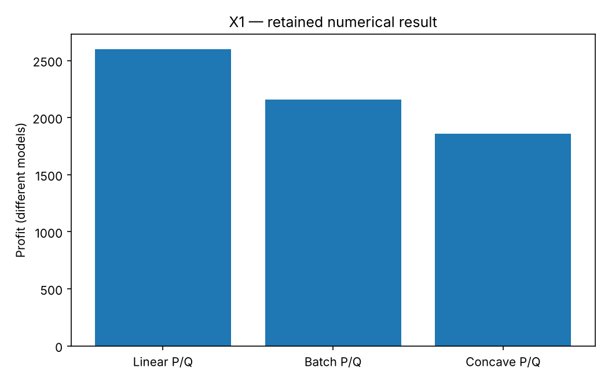

# X1: One workshop story, four solver choices

This chapter runs native Rust solvers through their Python APIs. Its model and independent checks live in this directory; the shared driver in optimization-jobs adds figures and command-job execution.

## Model and decision

Linear production uses capacities 2P+Q<=100 and P+Q<=80. Add batch sizes and setup costs for a MIP, decreasing margins for a smooth constrained model, then treat a six-product batch model as a black-box objective.

## Work through the lesson

The common workshop has machine limit $2P+Q\le100$ and labor limit $P+Q\le80$. Each variant declares a different decision model.

| Variant | Structure and native solver | Independent answer |
|---|---|---|
| A | Linear profit $40P+30Q$; LP-IP LP | $(20,60)$, profit 2600; all polygon vertices enumerated; dual prices 10 (machine) and 20 (labor) checked |
| B | Batches of 7 and 9, setup cost 150; LP-IP MIP | $(21,54)$, profit 2160; batch enumeration |
| C | Profit $(40-.25P)P+(30-.2Q)Q$; SQP | $(200/7,300/7)$, profit $91000/49$; closed-form KKT point, machine multiplier $-90/7$ in the $\nabla f=J^T\lambda+z$ convention |
| D | Six products exposed through a black-box callback; fcmaes Bite | Feasibility and measured gap to the same model's enumerated/MIP optimum |

Work through A→D and identify what changed before choosing a solver. D's returned value is `best_found`; the summary keeps the raw BiteOpt point and whether it is feasible, and reports no profit or gap for an infeasible one; a known MIP optimum provides a measured gap for that fixture, not a general guarantee for black-box optimization. The profit bars represent different models and are not a solver speed or quality ranking.

## Run

Install the pinned solver packages and scientific dependencies as described in the [shared setup](../structured/README.md), with the repositories it lists cloned side by side. From this repository's root:

```bash
python tutorials/structured/run.py --chapter X1 --output /absolute/new/x1
```

To run the chapter on its own, use `python tutorials/solver-choice/run.py --preset smoke --output /absolute/new/x1-direct`. It produces JSON; the shared driver additionally renders PNG/SVG figures. `--preset study` runs the larger declared cases; a chapter without them repeats the smoke case. Output may be new or empty, and an occupied directory is refused.

## Independent answer and validation

Linear profit is 2600 at (20,60). The two-product batch optimum is 2160 at (21,54). Concave profit is 91000/49 at (200/7,300/7). The six-product native MIP is checked against enumeration, then the fcmaes best-found gap is measured against that reference.

Every run keeps the native status, points and available diagnostics. Application-specific references are computed separately. All failures remain in the report.

## Read the result

Read `summary.json` before interpreting `figure.png`. The report records the actual result; expected reference values are not substituted for missing numerical outcomes. A completed command job means that the chapter's executable checks completed, while individual solver attempts can still be nonconvergent where the lesson explicitly retains them.

These are different formulations, not a shared solver performance ranking. Use linear/integer structure when available; global search is useful when that structure is unavailable.

## Agent prompt

> Choose a fitting solver for each of the four production-mix variants. Explain what changed in the decision model, verify every answer with its own reference, and report black-box search as best found with a measured gap to the same-model MIP optimum.

Use the complete [prompt](prompt.md) for the workflow and evidence requirements.

## Follow-up exercise

Choose a solver from the shared guide before running each variant. Explain why a black-box approximation to an LP still returns best-found evidence.

## Provenance and limits

The checked-in `results/` record one run of each preset. The shared driver writes source and package identities to `environment.json` for the runs it makes. These are reproducible teaching experiments, not industrial or hardware performance certifications. Tables that compare formulations or solvers are descriptive.

## Recorded example



Inspect the [complete smoke summary](results/smoke/summary.json) alongside the figure.

The [study summary](results/study/summary.json) and [study figure](results/study/figure.png) record the study preset.
